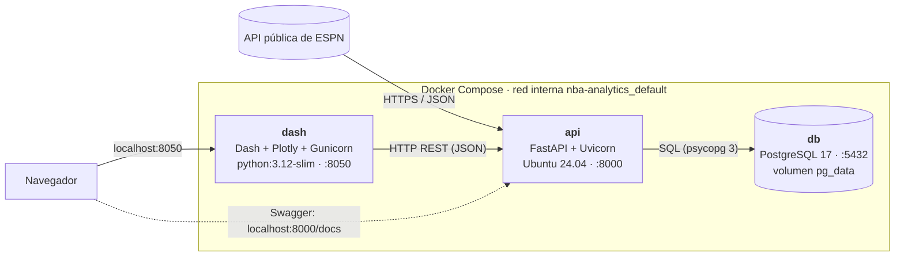
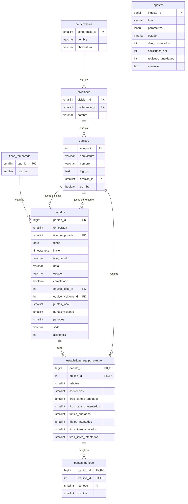

# Guía del proyecto: NBA Analytics

Prototipo de visualización de datos con **Docker, API y bases de datos**. Primera versión (v1.0).

Esta guía explica qué se construyó, por qué y cómo presentarlo. Las secciones 2 a 6 siguen el orden
de lo que pide el entregable: problemática, API, arquitectura, base de datos y demostración.

---

## 1. Resumen

| | |
|---|---|
| **Tema** | Básquetbol: rendimiento de los equipos de la NBA |
| **Fuente externa** | API pública de ESPN (JSON por HTTPS, sin API key) |
| **Obtención** | Contenedor `api`: **FastAPI sobre Ubuntu 24.04** con un proceso ETL y scripts de carga |
| **Almacenamiento** | Contenedor `db`: **PostgreSQL 17** (8 tablas + 2 vistas analíticas) |
| **Visualización** | Contenedor `dash`: **Python + Dash + Plotly**, servido con Gunicorn |
| **Orquestación** | Docker Compose (`compose.yaml`), red interna y healthchecks |
| **Datos de prueba** | Temporada 2025-26 completa: 1,401 partidos en ~1.5 minutos (230 solicitudes a ESPN) |

### Cómo cumple cada criterio de la tarea

| Criterio | Implementación |
|---|---|
| 1. Obtención de datos vía API (contenedor API-Ubuntu) | `api/` usa la imagen `ubuntu:24.04`. `app/espn.py` consume ESPN e `app/ingesta.py` hace el ETL. Se lanza desde el dashboard, desde Swagger, con un script o en automático cada 60 min. |
| 2. Almacenamiento en un DBMS (contenedor BD) | `db` usa PostgreSQL 17. El esquema se crea solo al primer arranque desde `db/init/`. |
| 3. Visualización (contenedor Python-Dash) | `dash/app.py`: 5 indicadores, 4 gráficas interactivas, clasificación por conferencia y tabla de partidos. |
| 4. Contenerización (≥ 2 contenedores) | 3 contenedores: `db`, `api` y `dash`. |
| 5. Integración de punta a punta | ESPN → `api` → `db` → `api` → `dash`. Los contenedores se comunican por nombre de servicio (`db:5432`, `api:8000`) dentro de la red de Compose. |

---

## 2. Problemática

La información de la NBA está disponible, pero **dispersa y efímera**: los sitios deportivos muestran
el marcador del día o la tabla de hoy, y no dejan hacer preguntas analíticas sobre una temporada:

- ¿Qué equipos anotan mucho, pero también reciben muchos puntos?
- ¿El récord de un equipo refleja su dominio real (diferencial de puntos) o tuvo suerte en partidos cerrados?
- ¿En qué cuarto suele despegarse o caerse un equipo?
- ¿Cómo evolucionó su rendimiento partido a partido?

**Necesidad que atiende:** construir un **histórico propio y consultable** de partidos con un proceso
automatizado de obtención, y un tablero que convierta esos datos en comparaciones visuales para
aficionados, analistas, periodistas o cuerpos técnicos.

---

## 3. API seleccionada: ESPN (pública)

ESPN expone, sin autenticación, los mismos datos JSON que alimentan su sitio web. Se usan tres endpoints:

| Endpoint | Qué devuelve | Uso en el proyecto |
|---|---|---|
| `GET https://site.api.espn.com/apis/site/v2/sports/basketball/nba/teams` | Los 30 equipos: id, abreviatura, nombre, colores, logo | Catálogo `equipos` |
| `GET https://site.api.espn.com/apis/v2/sports/basketball/nba/standings?level=3` | Árbol liga → conferencias → divisiones → equipos | Catálogos `conferencias` y `divisiones` |
| `GET https://site.api.espn.com/apis/site/v2/sports/basketball/nba/scoreboard?dates=AAAAMMDD` | Todos los partidos de un día: estado, marcador, sede, asistencia, **box score por equipo** y **puntos por cuarto** | `partidos`, `estadisticas_equipo_partido`, `puntos_periodo` |
| `GET .../scoreboard?dates=AAAA` | Calendario de la temporada (días con partidos) | Saber qué días consultar al cargar una temporada |

Fragmento real de la respuesta del scoreboard (simplificado):

```json
{
  "id": "401810433",
  "date": "2026-01-15T19:00Z",
  "season": {"year": 2026, "type": 2},
  "competitions": [{
    "attendance": 13738,
    "venue": {"fullName": "Uber Arena", "address": {"city": "Berlin"}},
    "notes": [{"headline": "NBA Berlin Game 2026"}],
    "competitors": [{
      "homeAway": "home",
      "team": {"id": "19", "abbreviation": "ORL"},
      "score": "118",
      "linescores": [{"period": 1, "value": 23}, {"period": 2, "value": 35}],
      "statistics": [{"name": "rebounds", "displayValue": "54"},
                     {"name": "assists", "displayValue": "28"}]
    }]
  }]
}
```

**Por qué esta API:** no requiere registro ni clave, trae datos actuales (incluida la temporada 2026-27
en curso) y su respuesta es rica (marcador, cuartos, box score) en una sola solicitud por día.

**Limitaciones que conviene mencionar:** es una API **no oficial ni documentada**, así que ESPN podría
cambiarla sin aviso. Durante el desarrollo comprobamos que **no acepta rangos de fechas**
(`dates=20260101-20260131` responde 400), por eso el ETL consulta **un día a la vez** y hace una
pausa de 0.2 s entre solicitudes para no saturar el servicio.

---

## 4. Arquitectura



| Contenedor | Imagen | Función | Puerto publicado |
|---|---|---|---|
| `db` | `postgres:17` | Guarda equipos, partidos, estadísticas y la bitácora del ETL. Crea el esquema desde `db/init/` en el primer arranque. | `127.0.0.1:5433` (opcional, para pgAdmin/DBeaver) |
| `api` | `nba-api:local` (construida desde `ubuntu:24.04`) | 1) Consume la API de ESPN y ejecuta el ETL. 2) Expone una API REST con los datos almacenados. 3) Sincroniza automáticamente ayer y hoy cada 60 min. | `127.0.0.1:8000` |
| `dash` | `nba-dash:local` (construida desde `python:3.12-slim`) | Dashboard interactivo. **No se conecta a la base**: todo lo pide a la API. También puede lanzar ingestas. | `127.0.0.1:8050` |

### Decisiones de arquitectura

- **Tres capas.** A diferencia del ejemplo del profesor (Dash leía MySQL directamente), aquí Dash solo
  habla con la API. La base queda detrás de una sola puerta y la lógica SQL vive en un único lugar.
- **Comunicación por nombre de servicio.** Dentro de la red de Compose, la API se conecta a `db:5432`
  y Dash a `http://api:8000`. `localhost` dentro de un contenedor apuntaría a sí mismo.
- **Orden de arranque con healthchecks.** `db` está *healthy* solo cuando el esquema existe (la prueba
  consulta la tabla `ingestas` por TCP). `api` espera a `db`, y `dash` espera a que `api` responda en `/salud`.
- **Puertos publicados solo en `127.0.0.1`.** Los servicios no quedan expuestos a la red local.
- **Usuarios sin privilegios.** `api` corre como `ubuntu` y `dash` como `dash`, no como root.
- **Persistencia.** Los datos viven en el volumen `pg_data`: sobreviven a `docker compose down`.

---

## 5. Proceso de obtención de datos (ETL)

Todo el ETL está en `api/app/ingesta.py`:

1. **Extracción** (`espn.py`): solicitudes HTTP con `httpx`, timeout de 20 s y 3 reintentos ante
   errores de red o respuestas 5xx.
2. **Transformación** (`transformar_evento`): convierte cada partido del JSON de ESPN en filas para
   nuestras tablas. Traduce conferencias y divisiones al español, convierte textos a enteros,
   identifica local y visitante, y descarta estadísticas de partidos que no han empezado.
3. **Carga** (`guardar_partidos`): `INSERT ... ON CONFLICT DO UPDATE` (*upsert*), un día por transacción.

Propiedades importantes para la demo:

- **Idempotente.** Volver a cargar el mismo rango no duplica nada: actualiza marcadores (útil para
  partidos que estaban en vivo).
- **Bitácora.** Cada ejecución queda en la tabla `ingestas` con su estado, días procesados,
  solicitudes a ESPN y registros guardados. El dashboard la consulta cada 3 s para mostrar el progreso.
- **Una a la vez.** Si ya hay una ingesta corriendo, la API responde `409 Conflict`.
- **Tolerante a reinicios.** Si la API se reinicia a mitad de una carga, al volver marca esa ingesta
  como "Interrumpida por reinicio de la API". Basta con relanzarla.
- **Cuatro formas de disparar el ETL:**

| Forma | Cómo |
|---|---|
| Dashboard | Botones *Obtener partidos* (rango de fechas), *Cargar temporada* y *Actualizar equipos* |
| Swagger | `POST /ingestas/partidos`, `POST /ingestas/temporada`, `POST /ingestas/equipos` en http://localhost:8000/docs |
| Script | `docker compose exec api python -m scripts.cargar_datos temporada 2026` |
| Automática | Cada `SINCRONIZACION_MINUTOS` (60 por defecto) descarga ayer y hoy. Al primer arranque carga los equipos. |

---

## 6. Diseño de la base de datos



| Tabla | Tipo | Contenido |
|---|---|---|
| `conferencias`, `divisiones` | Catálogo | Estructura de la liga (Este/Oeste y 6 divisiones) |
| `tipos_temporada` | Catálogo | Pretemporada, Temporada regular, Playoffs, Play-In |
| `equipos` | Catálogo | 30 equipos NBA más rivales de exhibición (`es_nba = FALSE`) |
| `partidos` | Hechos | Un renglón por partido: fecha, estado, local/visitante, marcador, sede |
| `estadisticas_equipo_partido` | Hechos | Box score de cada equipo en cada partido (relación N:M partidos-equipos) |
| `puntos_periodo` | Hechos | Puntos por cuarto (periodo 5 en adelante = prórrogas) |
| `ingestas` | Bitácora | Historial y avance del ETL (`parametros` en **JSONB**) |

**Vistas analíticas** (`db/init/02-vistas.sql`):

- `v_resultados_equipo`: "despliega" cada partido en dos renglones, uno por equipo
  (puntos a favor/en contra, ¿ganó?, ¿fue local?). Simplifica cualquier cálculo por equipo.
- `v_clasificacion`: récord, % de victorias, promedios, diferencial, local/visita y % de tiro por
  temporada y fase. **El dashboard calcula la clasificación aquí, a partir de los partidos guardados.**

**Decisiones de diseño:**

- **Llaves naturales de ESPN** como llave primaria (`partido_id`, `equipo_id`). Así el *upsert* es
  directo y las recargas no duplican datos.
- **Normalización (3FN).** Los porcentajes de tiro no se guardan: se calculan en la vista. "¿Es
  local?" se deduce de `partidos`, no se repite en las estadísticas.
- **Integridad.** Llaves foráneas en todas las relaciones, `CHECK (equipo_local_id <> equipo_visitante_id)`,
  `CHECK (periodo >= 1)` y `ON DELETE CASCADE` de un partido hacia sus estadísticas.
- **Índices** por `(temporada, tipo_temporada, fecha)` y por equipo local/visitante, que son los
  filtros que usa el dashboard.
- **SQL analítico en la base.** La media móvil de 10 partidos y el récord acumulado se calculan con
  **funciones de ventana** (`AVG() OVER (ROWS BETWEEN 9 PRECEDING AND CURRENT ROW)`).

> **Hallazgo durante el desarrollo:** la primera versión mostraba a San Antonio con 62-21 (83 partidos),
> pero el récord oficial es 62-20. ESPN marca la **final de la NBA Cup** como temporada regular,
> aunque la NBA no la cuenta en la clasificación. Se agregó la columna `tipo_partido` (ESPN la marca
> como `CC`) y la vista la excluye. Ahora los récords coinciden con los oficiales.

---

## 7. API REST (FastAPI)

Documentación interactiva en **http://localhost:8000/docs**, donde se pueden probar todos los endpoints.

| Método | Ruta | Descripción |
|---|---|---|
| GET | `/salud` | Estado de la API y versión de PostgreSQL |
| GET | `/equipos` | Catálogo de equipos |
| GET | `/temporadas` | Temporadas y fases con partidos almacenados |
| GET | `/partidos` | Partidos con filtros: `temporada`, `tipo`, `equipo_id`, `desde`, `hasta`, `limite` |
| GET | `/partidos/{id}` | Detalle con box score y puntos por cuarto |
| GET | `/estadisticas/resumen` | Indicadores generales de una temporada y fase |
| GET | `/estadisticas/clasificacion` | Clasificación con promedios y juegos detrás del líder |
| GET | `/estadisticas/equipos/{id}/tendencia` | Puntos partido a partido con media móvil |
| GET | `/estadisticas/puntos-por-periodo` | Promedio por cuarto: equipo frente a liga |
| POST | `/ingestas/equipos` | Descarga equipos, conferencias y divisiones |
| POST | `/ingestas/partidos` | Descarga un rango de fechas. Cuerpo: `{"desde": "2026-01-01", "hasta": "2026-01-07"}` |
| POST | `/ingestas/temporada` | Descarga una temporada. Cuerpo: `{"temporada": 2026}` |
| GET | `/ingestas`, `/ingestas/{id}` | Historial y estado de las ingestas |

Los `POST` responden `202 Accepted` de inmediato (la descarga corre en segundo plano), `409` si ya
hay otra ingesta en curso y `422` si los parámetros no son válidos (por ejemplo, `hasta` < `desde`).

---

## 8. Dashboard (Dash)

http://localhost:8050

1. **Obtención de datos.** Botones para lanzar el ETL, barra de progreso en vivo e historial de ingestas.
2. **Filtros** (fijos al hacer scroll): temporada, fase y equipo. Todas las gráficas responden a ellos.
3. **Indicadores:** partidos jugados, puntos por equipo y partido, mejor récord, partido con más
   puntos y última actualización.
4. **Ofensiva vs. defensiva** (dispersión): cada equipo según los puntos que anota y los que permite.
   El eje vertical está invertido, así que arriba a la derecha quedan los equipos que anotan más y
   permiten menos. El equipo seleccionado aparece con un anillo.
5. **Diferencial de puntos** (barras divergentes): azul positivo, rojo negativo.
6. **Clasificación** por conferencia, con logos. Marca playoffs directos (1-6) y Play-In (7-10).
7. **Vista de equipo:** récord total, de local y de visita; puntos por partido con media móvil de 10
   juegos; puntos por cuarto frente al promedio de la liga; últimos 10 partidos.

Cuando termina una ingesta, el dashboard se recarga solo con los datos nuevos.

---

## 9. Estructura de archivos

```
TareaJP/
├── compose.yaml              # Orquestación de los 3 contenedores
├── .env.example              # Plantilla de variables (copiar a .env)
├── README.md                 # Arranque rápido
├── GUIA.md                   # Esta guía
├── db/
│   ├── init/
│   │   ├── 01-esquema.sql    # Tablas, llaves, índices y catálogo de fases
│   │   └── 02-vistas.sql     # v_resultados_equipo y v_clasificacion
│   └── consultas_demo.sql    # Consultas para mostrar en clase (no se ejecuta al iniciar)
├── api/                      # Contenedor API-Ubuntu
│   ├── Dockerfile            # FROM ubuntu:24.04 + venv de Python
│   ├── requirements.txt
│   ├── app/
│   │   ├── main.py           # Endpoints FastAPI, arranque y sincronización automática
│   │   ├── espn.py           # Cliente de la API de ESPN (extracción)
│   │   ├── ingesta.py        # ETL: transformación, carga, bitácora y tareas
│   │   ├── consultas.py      # SQL de lectura para los endpoints
│   │   ├── db.py             # Pool de conexiones a PostgreSQL
│   │   └── config.py         # Variables de entorno
│   └── scripts/
│       └── cargar_datos.py   # Carga desde la terminal (mismo ETL)
└── dash/                     # Contenedor Python-Dash
    ├── Dockerfile            # FROM python:3.12-slim + Gunicorn
    ├── requirements.txt
    ├── app.py                # Layout, callbacks y gráficas
    └── assets/estilos.css    # Estilos (Dash los carga automáticamente)
```

---

## 10. Cómo ejecutarlo

1. Abre Docker Desktop y espera a que diga que está corriendo.
2. Abre una terminal en la carpeta del proyecto (`TareaJP`).
3. Crea el archivo de variables:

```bash
cp .env.example .env
```

4. Construye y levanta los contenedores. La primera vez descarga imágenes y librerías, y puede tardar unos minutos:

```bash
docker compose up -d --build
```

5. Verifica que `db` y `api` aparezcan como `healthy`:

```bash
docker compose ps
```

6. Abre http://localhost:8050 y pulsa **Cargar temporada** con 2025-26 seleccionada. En ~1.5 min tendrás 1,401 partidos.

> **Consejo para la clase:** carga la temporada completa **antes** de la presentación. Durante la
> demo usa el botón de **rango de fechas** (7 días tardan ~3 s) para mostrar el flujo en vivo.

---

## 11. Guion sugerido para la demostración (5-7 min)

1. **Problemática (30 s).** "Los datos de la NBA están dispersos y solo muestran el día; quiero un
   histórico consultable y comparativo."
2. **Arquitectura (1 min).** Muestra el diagrama de la sección 4 y luego `docker compose ps` con los
   3 contenedores *healthy*.
3. **API de ESPN (45 s).** Abre en el navegador
   `https://site.api.espn.com/apis/site/v2/sports/basketball/nba/scoreboard?dates=20260115`
   y señala marcador, cuartos y estadísticas en el JSON.
4. **Obtención en vivo (1 min).** En el dashboard elige un rango (por ejemplo, la última semana de
   pretemporada) y pulsa **Obtener partidos**. Señala la barra de progreso y la nueva fila en el
   historial. Opcional: lanza lo mismo desde Swagger (`/docs` → `POST /ingestas/partidos` → *Try it out*).
5. **Almacenamiento (1 min).** Muestra el diagrama ER y ejecuta las consultas de demostración:

```bash
docker compose exec -T db psql -U nba_user -d nba < db/consultas_demo.sql
```

   Muestran registros por tabla, la bitácora de ingestas, los últimos partidos, la clasificación
   desde la vista, el box score por cuartos y las rachas de victorias calculadas con funciones de ventana.
6. **Visualización (2 min).** En el dashboard:
   - Ofensiva vs. defensiva: "OKC está solo arriba a la derecha: anotó 119 y permitió 107.9 por partido".
   - Cambia de equipo y de fase (Temporada regular → Playoffs) para mostrar que todo se recalcula.
   - Vista de equipo: tendencia y cuartos.
7. **Cierre (30 s).** Integración completa ESPN → FastAPI → PostgreSQL → FastAPI → Dash, todo en Docker.

---

## 12. Comandos útiles

```bash
docker compose logs -f api
```

```bash
docker compose logs -f dash
```

```bash
docker compose exec db psql -U nba_user -d nba
```

```bash
docker compose exec api python -m scripts.cargar_datos partidos --desde 2026-01-01 --hasta 2026-01-07
```

```bash
docker compose exec api python -m scripts.cargar_datos recientes
```

```bash
docker compose up -d --build --no-deps dash
```

`--no-deps` reconstruye solo un servicio sin reiniciar los demás. Úsalo para no interrumpir una
carga en curso de la API.

```bash
docker compose stop
```

```bash
docker compose down
```

`docker compose down -v` borra también el volumen con la base de datos. Úsalo solo si quieres
empezar desde cero, por ejemplo después de modificar los archivos de `db/init/`.

---

## 13. Problemas frecuentes

| Síntoma | Solución |
|---|---|
| `Cannot connect to the Docker daemon` | Abre Docker Desktop y espera a que termine de iniciar. |
| Puerto 8050, 8000 o 5433 ocupado | Cambia el primer número del mapeo en `compose.yaml` (por ejemplo, `127.0.0.1:8051:8050`). |
| `db` nunca llega a *healthy* | Revisa `docker compose logs db`. Un error en un `.sql` de `db/init/` detiene la inicialización. |
| Cambié `db/init/*.sql` y no pasa nada | Esos scripts solo corren con el volumen vacío. Usa `docker compose down -v` y vuelve a levantar. |
| `password authentication failed` tras editar `.env` | El volumen conserva la contraseña original. Restaura la anterior o borra el volumen con `down -v`. |
| La ingesta termina en "error" | Lee la columna *Detalle* del historial. Normalmente es un problema de Internet o ESPN no respondió. Vuelve a lanzarla: es idempotente. |
| El dashboard dice "Esperando a la API…" | La API está arrancando o se cayó. Revisa `docker compose logs api`. |

---

## 14. Limitaciones y siguientes pasos (v2)

- **Jugadores:** líderes por partido y estadísticas individuales (ESPN también las expone).
- **Modelo predictivo:** probabilidad de victoria según diferencial, localía y racha.
- **Pruebas automatizadas** del ETL con respuestas de ESPN guardadas como *fixtures*.
- **Modo oscuro** y exportación de gráficas o tablas.
- **Migraciones** (Alembic) en lugar de scripts de inicialización, para evolucionar el esquema sin borrar datos.
- **Autenticación** en los endpoints `POST /ingestas/*` si el sistema se publicara fuera de `localhost`.
- **Respaldo de la fuente:** al ser una API no oficial, documentar una alternativa (por ejemplo,
  balldontlie.io con API key) por si ESPN cambia su formato.
